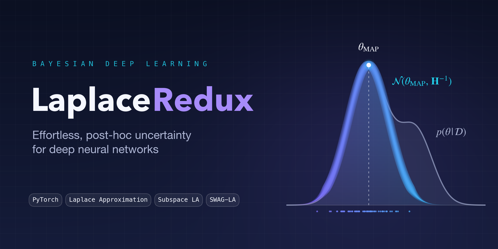

<div align="center">



**A reproduction and extension of the Laplace Approximation for uncertainty quantification in deep neural networks**


[](LICENSE)

[Overview](#overview) · [Contributions](#contributions) · [Results](#results) · [Getting Started](#getting-started) · [Blog](BLOG.md) · [License](#license)

</div>

---

## Overview

Deep neural networks are notoriously overconfident: they rarely say "I don't know," even on inputs far outside their training distribution. The **Laplace Approximation (LA)** addresses this post hoc. It takes a conventionally trained network (the MAP estimate, $\theta_{MAP}$) and fits a Gaussian posterior around its weights, turning a deterministic model into a Bayesian one without retraining.

This project reproduces the out-of-distribution (OOD) detection results of *"Laplace Redux – Effortless Bayesian Deep Learning"* (Daxberger et al., NeurIPS 2021) and extends the authors' [`laplace`](https://github.com/aleximmer/Laplace) library and [experiment pipeline](https://github.com/runame/laplace-redux) in four directions.

## Contributions

| Area | Description |
|:-----|:------------|
| **Reproduction** | Integrated the original algorithm and experiment codebases and reproduced Table 1 (MNIST and CIFAR-10 OOD detection). Test-time cost was added as a metric. |
| **Subspace Laplace** | A new LA variant that fits a *full* covariance inside a low-dimensional subspace spanned by the top Hessian eigenvectors, found with stochastic power iteration and Hessian-vector products. See [`laplace/subspace_laplace.py`](laplace/subspace_laplace.py). |
| **SWAG-Laplace** | A new LA variant that builds a low-rank plus diagonal posterior covariance from Stochastic Weight Averaging-Gaussian (SWAG) snapshots instead of an explicit Hessian. See [`laplace/swag_laplace.py`](laplace/swag_laplace.py). |
| **New dataset** | Evaluated LA and both new variants on the tabular **UCI Adult** dataset, including gender-based domain shift and increasing Gaussian feature noise. |
| **Hyperparameter sensitivity** | Studied how prior precision, Hessian structure (diag vs. KFAC), link approximation (probit vs. bridge) and temperature interact across six architectures. See [`hyperparams/`](hyperparams/). |

## Results

The full methodology, results tables, figures and discussion are in the **[project blog](BLOG.md)**:

- [Reproduction of Table 1](BLOG.md#reproduction-of-table-1): MNIST and CIFAR-10 OOD detection
- [Subspace Laplace results](BLOG.md#31-subspace-laplace-results)
- [SWAG-Laplace results](BLOG.md#32-swag-laplace-results)
- [Results on UCI Adult](BLOG.md#33-results-on-new-datasets)
- [Hyperparameter sensitivity results](BLOG.md#34-hyperparameter-sensitivity-results)

## Repository Structure

```
.
├── laplace/            # Fork of the `laplace` library, including the new variants
│   ├── subspace_laplace.py
│   └── swag_laplace.py
├── tests/              # Experiment pipeline adapted from laplace-redux
│   ├── uq.py           # Main uncertainty-quantification entry point
│   └── run_uq_*.sh     # Experiment scripts
├── hyperparams/        # Hyperparameter sensitivity notebooks, models and plots
├── assets/             # README banner and GitHub social preview (+ generator script)
├── blog_images/        # Figures used in the blog
├── BLOG.md             # Full write-up of the project
├── Dockerfile
├── docker-compose.yml
└── LICENSE
```

## Getting Started

### Prerequisites

- [Docker](https://docs.docker.com/get-docker/) with Docker Compose
- An NVIDIA GPU with the [NVIDIA Container Toolkit](https://docs.nvidia.com/datacenter/cloud-native/container-toolkit/install-guide.html) (the container is built on CUDA 12.1)

### Setup

1. **Clone the repository**

   ```bash
   git clone https://github.com/denskrlv/LaplaceRedux.git
   cd LaplaceRedux
   ```

2. **Download the pretrained models** from [Google Drive](https://drive.google.com/file/d/17cI3dhconEwLj5J3XTEgbPlzYTUoSxAk/view?usp=share_link) and extract them into a `models/` directory at the repository root. Compose mounts this directory into the container at `tests/models`.

3. **Build and start the container**

   ```bash
   ./run.sh
   ```

   This is equivalent to `docker compose build && docker compose up -d`.

### Running Experiments

Run the experiment scripts inside the container:

| Experiment | Command |
|:-----------|:--------|
| Baselines (MAP, DE, VB, HMC, SWAG) | `docker compose exec laplace ./tests/run_uq_baselines.sh` |
| Laplace Approximation | `docker compose exec laplace ./tests/run_uq_laplace.sh` |
| Subspace Laplace | `docker compose exec laplace ./tests/run_uq_subspace.sh` |
| SWAG-Laplace | `docker compose exec laplace ./tests/run_uq_swag.sh` |
| UCI Adult suite | `docker compose exec laplace ./tests/run_uq_adult.sh` |
| Quick smoke test (single seed) | `docker compose exec laplace ./tests/run_all.sh` |

The hyperparameter sensitivity study lives in the Jupyter notebooks under [`hyperparams/`](hyperparams/).

## Team

| Member | Contribution |
|:-------|:-------------|
| Serkan Akın | Evaluation on additional datasets |
| Samuel Goldie | Subspace Laplace variant |
| Denis Krylov | SWAG-Laplace variant |
| Alberto Pasinato | Hyperparameter sensitivity analysis |

## Acknowledgements

This work builds on the [`laplace`](https://github.com/aleximmer/Laplace) library and the [`laplace-redux`](https://github.com/runame/laplace-redux) experiment code by the original authors.

## License

This project is released under the [MIT License](LICENSE). Code in `laplace/` and `tests/` is derived from the MIT-licensed [`laplace`](https://github.com/aleximmer/Laplace) and [`laplace-redux`](https://github.com/runame/laplace-redux) projects and keeps its original copyright notices.
